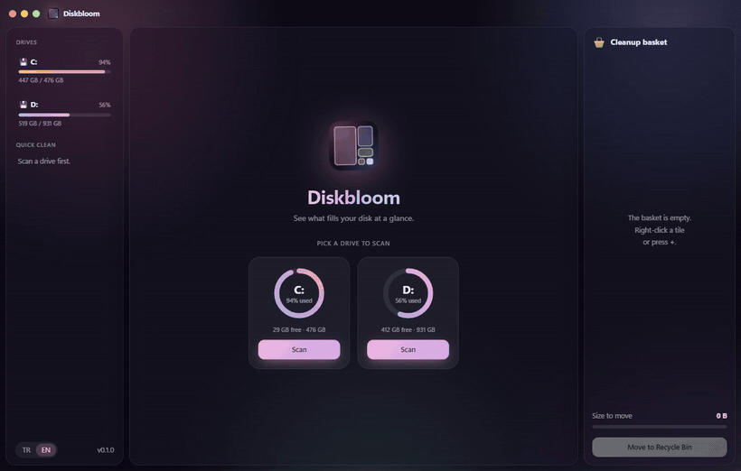
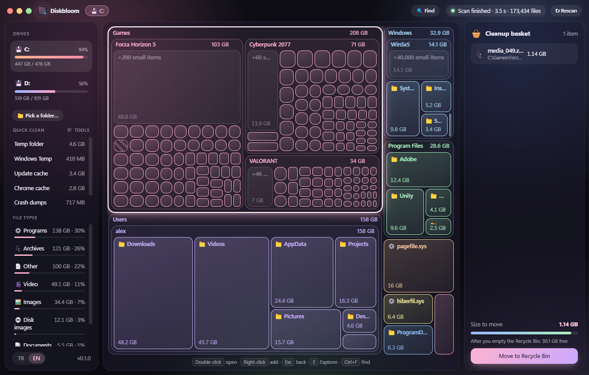
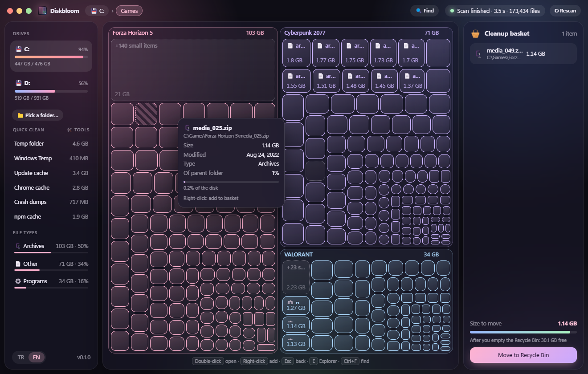

<div align="center">


# Diskbloom

**See what fills your disk at a glance — then clean it, safely.**

A pastel, animated disk space visualizer and cleaner for Windows, in the spirit of SpaceSniffer.



</div>

## Features

- **Treemap of your drive.** Every folder and file is a rounded tile; its area is its size. Labels show the name and size.
- **Any drive or folder.** Scan a whole drive, or pick one folder (Downloads, a game library, a project) for a quick look.
- **Explorer menu.** Turn on *Explorer menu* in the side panel, then right-click any folder or drive and pick **Scan with Diskbloom**. On Windows 11 it is under *Show more options*. The open window takes the folder; a second window does not open.
- **Fast native scan.** A small multi-threaded scanner reads the file system directly. A full system drive with 1.3 million files takes about 10 seconds on an SSD.
- **The map grows while it scans.** You can start exploring before the scan is finished.
- **Zoom into any folder.** Double-click a tile and the map flies into it. Press <kbd>Esc</kbd> or use the path pills to go back.
- **File types.** The side panel lists what fills the open folder: video, images, audio, archives, disk images, programs, documents, code and other. Click a type and only its tiles stay bright on the map.
- **Floating details.** A glass tooltip follows the mouse with size, item and file counts, and the share of the parent folder and the disk.
- **Cleanup basket.** Right-click tiles (or press <kbd>+</kbd>) to collect files and folders from anywhere on the drive, then move them all at once.
- **Safe by design.**
  - Everything goes to the **Recycle Bin**, never straight to deletion, and only after you confirm.
  - Windows, installed programs, page and hibernation files, drive roots and your profile's top folders are locked.
  - The free-space bar is honest: the space comes back only after you empty the Recycle Bin.
- **Quick clean.** One click adds the contents of Temp, browser caches, the Windows Update download cache, crash dumps and developer caches (npm, pip, Gradle, NuGet) when they exist.
- **Administrator rescan** for folders that a normal user cannot read.
- **Turkish and English** interface.

<p align="center">
  
  
</p>

## Use it

| Action | Mouse | Keyboard |
| --- | --- | --- |
| Scan a folder | *Pick a folder…*, or right-click it in Explorer | |
| Light up one file type | Click it under *File types* (click again to turn it off) | |
| Select a tile | Click | |
| Open a folder | Double-click | <kbd>Enter</kbd> |
| Go up | Click a path pill | <kbd>Esc</kbd> / <kbd>Backspace</kbd> |
| Add to / remove from basket | Right-click or the <kbd>+</kbd> badge | <kbd>Space</kbd> / <kbd>Delete</kbd> |
| Show in Explorer | 📂 in the basket | <kbd>E</kbd> |

## Build from source

Requirements: Windows 10 or 11, [Node.js](https://nodejs.org) 20 or newer.

```sh
npm install
npm run build:scanner   # compiles native/scanner.cs with the C# compiler that ships with Windows
npm start               # run the app
npm run demo            # run with a made-up drive (safe for screenshots and talks)
npm test                # unit tests
npm run e2e             # end-to-end smoke test on your real drive (moves one test file it creates to the Recycle Bin)
npm run dist            # portable .exe and installer in dist/
```

`Diskbloom.exe --scan=D:\Games` opens the app and scans that folder at once.

## How it works

```
native/scanner.cs        multi-threaded FindFirstFileEx walker, streams one line per entry
src/main/scan-host.js    Electron utility process: runs the scanner and owns the tree
src/main/tree.js         in-memory tree, rolled-up sizes, bounded snapshots for the UI
src/main/main.js         window, IPC, Recycle Bin moves, protection checks
src/main/launch.js       turns --scan and dialog paths into a checked scan root
src/main/explorer-menu.js  the "Scan with Diskbloom" entry in the current user's registry
src/shared/protect.js    the rules for paths that can never be moved
src/shared/filetypes.js  file extensions grouped into the nine file types
src/renderer/            the UI: squarified treemap, tooltip, basket, animations
```

The scanner skips junctions and symbolic links so nothing is counted twice. The tree lives in a separate process, so a scan of millions of files never freezes the window. The UI asks only for what it can draw: small items are folded into one "+N small items" tile.

## Türkçe

Diskbloom, Windows için pastel renkli ve animasyonlu bir disk alanı görüntüleyicisi ve temizleyicisidir. Diskinizi taşıyan klasörleri dikdörtgenlerle gösterir. Tüm diski veya yalnızca bir klasörü tarayabilirsiniz. "Dosya türleri" listesi klasördeki videoları, görselleri, programları ve diğer türleri gösterir. Bir türe tıklayınca haritada yalnızca o türdeki kutular parlak kalır. Explorer menüsünü açın ve bir klasöre sağ tıklayarak "Diskbloom ile tara" seçin. Bir klasöre çift tıklayarak içine girin. Sağ tıklayarak dosyaları silme sepetine ekleyin. Diskbloom dosyaları onayınızdan sonra Geri Dönüşüm Kutusuna taşır. Sistem dosyalarını ve kurulu programları silmez.

## License

[MIT](LICENSE)
